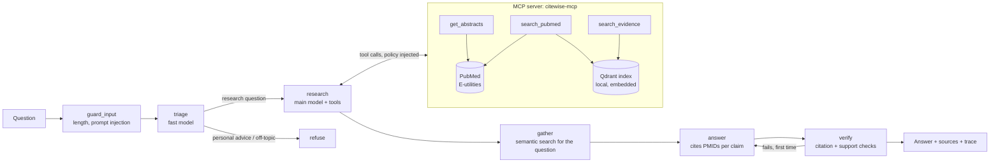

# Citewise

A biomedical research agent that answers only with evidence it can cite. Ask a research question;
the agent searches PubMed through its own MCP server, reads abstracts, answers from what it read,
and checks every citation before showing it. Claims that fail the check are removed, never shown.

Built with Claude (via LangChain), LangGraph, the Model Context Protocol, Qdrant and FastAPI.

**Status: v1.** Agent, MCP server, guardrails, evaluation harness, tracing, API and demo page are
in this repository, with 45 offline tests. The evaluation numbers below come from running
`citewise-eval` with a real API key (see [Evaluate](#evaluate)).

## How it fits together



The agent is a LangGraph state graph (`src/citewise/agent.py`):

1. **guard_input** rejects empty, overlong and prompt-injection inputs before any model is called.
2. **triage** (fast model) refuses personal medical advice and off-topic requests, and suggests
   PubMed queries.
3. **research** (main model) calls the MCP tools: search PubMed, read abstracts, search the index.
   A tool budget caps the loop.
4. **tools** runs each call with the evidence policy injected, then filters the results again.
5. **gather** always runs a semantic search of the index for the question, so the answer is
   grounded even if the model searched poorly. If the model made no tool calls, gather searches
   PubMed for it first.
6. **answer** (main model) answers from the evidence only, as claims that each cite PMIDs.
7. **verify** checks the citations, then asks the fast model whether the cited passages support each
   claim. A failing answer goes back once with the problems listed; claims that still fail are
   removed, and if nothing survives the verdict becomes `insufficient_evidence`.

The knowledge service is a separate MCP server (`src/citewise/mcp_server.py`). The agent loads its
tools with `langchain-mcp-adapters` over one long-lived stdio session. Any other MCP client, such as
Claude Desktop, can use the same server.

## Guardrails

| Where | What | How it is tested |
| --- | --- | --- |
| Input | Length limits; prompt-injection patterns; triage refuses personal medical advice and off-topic questions | `test_input_checks`, `test_prompt_injection_is_refused_before_any_model_call`, `test_personal_medical_advice_is_refused_by_triage` |
| Tools | An evidence policy (excluded PMIDs, latest publication year) is injected into every tool call and hidden from the model, so the model cannot widen what it may read. Every tool result is filtered again in the agent. | `test_excluded_and_later_papers_never_reach_the_evidence`, `test_policy_is_enforced_even_if_a_tool_returns_forbidden_papers` |
| Retrieved text | Abstracts are wrapped as untrusted `<document>` blocks; tags inside them are neutralised | `test_evidence_is_wrapped_as_untrusted_documents`, `test_documents_cannot_close_their_own_wrapper` |
| Output | Every claim must cite a PMID that the agent actually retrieved; a verdict needs at least one cited claim; a model check confirms the cited passages support each claim | `test_invented_citation_triggers_a_retry_with_feedback`, `test_claims_that_keep_failing_are_removed_not_shown`, `test_unsupported_claims_are_caught_by_the_support_check` |
| Cost | Tool budget per question; per-client rate limit and daily token budget in the API | `test_tool_budget_stops_a_model_that_never_stops_searching`, `test_rate_limit_per_client`, `test_daily_budget_stops_the_demo` |
| Secrets | The MCP server subprocess gets only `CITEWISE_*`, `NCBI_*` and system variables, never the Claude API key | `config.server_environment` |

## Evaluate

[PubMedQA](https://github.com/pubmedqa/pubmedqa) (Jin et al., EMNLP 2019) has 1,000 expert-labelled
yes/no/maybe questions; the official test split is 500. Each question is the title of a PubMed
paper. `citewise-eval` compares three settings on the same questions:

| Setting | What the model sees |
| --- | --- |
| `closed_book` | Nothing but the question. Claude answers from its own knowledge. |
| `with_context` | The paper's own abstract without its conclusion: the standard PubMedQA setting, used as an upper reference point. |
| `agent` | Whatever the agent finds in PubMed, **with the source paper excluded and only papers from earlier years allowed.** |

The `agent` setting is the honest one. Without the exclusion the agent would simply find the
question's own paper and read the answer in its conclusion; without the year limit it could read
later papers that cite it. Both rules go through the same evidence policy as in production, and the
report counts any question where the source paper still reached the evidence (it must be 0).

```bash
citewise-eval --download --limit 100                      # 100 random test questions, 3 settings
citewise-eval --limit 500 --modes agent --concurrency 3   # the full test split, agent only
citewise-eval --limit 30 --modes agent --gate agent:0.55  # exit code 2 if accuracy < 0.55
```

Results are written per question to `results/<model>/<mode>.jsonl`, so an interrupted run resumes
where it stopped, and summarised in `results/<model>/report.md` and `report.json`: accuracy and
macro-F1 with bootstrap 95% intervals, paired differences between settings on the same questions,
mean tokens and latency, and agent behaviour (tool calls, claims removed by the verifier,
`insufficient_evidence` rate).

### Results

_Not run yet. Run `citewise-eval --download --limit 100` and paste `results/<model>/report.md` here._

How to read them: `with_context` should score highest because the model reads the paper itself.
The interesting comparison is `agent` against `closed_book`: does retrieving earlier literature
help beyond what the model already knows? If the paired interval contains zero, the data cannot
tell them apart, and the report says so. Agent answers of `insufficient_evidence` are scored as
`maybe`, which costs accuracy when the true label is yes or no; that is the price of refusing to
guess.

## Observability

Every response carries a trace: time per step, tokens per model, tool calls with their arguments
and result counts, and the estimated cost if `CITEWISE_PRICES` is set. Each run also writes one
JSON log line (`agent_run`). With `LANGFUSE_PUBLIC_KEY` and `LANGFUSE_SECRET_KEY` set and
`pip install ".[tracing]"`, every model call is also sent to Langfuse.

## Run it

You need Python 3.11+ (or Docker) and a Claude API key. Every command reads `.env` from the current
folder, so put your settings there once:

```bash
cp .env.example .env            # Windows: copy .env.example .env
# then add ANTHROPIC_API_KEY and NCBI_EMAIL to .env
```

With Docker:

```bash
docker compose up --build       # then open http://127.0.0.1:8000
```

Without Docker (macOS/Linux; on Windows use `.venv\Scripts\activate`, or a conda environment):

```bash
python -m venv .venv && source .venv/bin/activate
pip install -e ".[dev]"
pytest                          # 45 tests, offline, no API key needed

citewise-ask "Does vitamin D supplementation reduce fracture risk in older adults?"
citewise-api                    # http://127.0.0.1:8000
```

The first run downloads a small embedding model (BAAI/bge-small-en-v1.5, via fastembed). The
evidence index is kept in `.citewise/index` (in Docker, a named volume). Embedded Qdrant allows one
process per index folder, so give the API and an evaluation run different `CITEWISE_INDEX_PATH`
values if you run both at once.

### Use the MCP server from Claude Desktop

```json
{
  "mcpServers": {
    "citewise": {
      "command": "/path/to/citewise/.venv/bin/citewise-mcp",
      "env": { "NCBI_EMAIL": "you@example.com" }
    }
  }
}
```

`citewise-mcp --http --port 8765` serves the same tools over streamable HTTP instead of stdio.

## Configuration

| Variable | Default | Purpose |
| --- | --- | --- |
| `ANTHROPIC_API_KEY` | (required) | Claude API key |
| `CITEWISE_MODEL` | `claude-sonnet-5-5` | Research and answer model |
| `CITEWISE_FAST_MODEL` | `claude-haiku-5-5` | Triage and citation-support model |
| `CITEWISE_MAX_TOOL_CALLS` | `6` | Tool budget per question |
| `CITEWISE_CHECK_SUPPORT` | `1` | Set `0` to skip the model support check (citation checks always run) |
| `CITEWISE_MAX_TOKENS` | `8192` | Output token limit per call, with room for adaptive thinking |
| `CITEWISE_EFFORT` | | Optional reasoning effort (`low`, `medium`, `high`) |
| `CITEWISE_STRUCTURED_OUTPUT` | `json_schema` | Anthropic native structured outputs; `function_calling` for older models |
| `NCBI_EMAIL`, `NCBI_API_KEY` | | NCBI contact and rate limit (3/s without key, 10/s with) |
| `CITEWISE_INDEX_PATH` | `.citewise/index` | Qdrant folder, or `:memory:` |
| `CITEWISE_EMBEDDING_MODEL` | `BAAI/bge-small-en-v1.5` | fastembed model |
| `CITEWISE_PRICES` | | JSON, model to [input, output] USD per million tokens, for cost estimates |
| `CITEWISE_RATE_LIMIT_PER_MINUTE` | `5` | Per client, API only |
| `CITEWISE_DAILY_TOKEN_BUDGET` | `2000000` | Across all clients, API only |

## Tests

`pytest` runs 45 tests with no network and no API key, against a small set of clearly synthetic
papers (`tests/fixtures/papers.json`, PMIDs 90000001 to 90000008). Besides unit tests they cover:

- **The real MCP path**: the server runs as a subprocess and the agent talks to it over stdio through
  `langchain-mcp-adapters`.
- **The real Claude path**: `ChatAnthropic` with tool calling and structured output runs against a
  local mock of the Anthropic Messages API, using the real model names (langchain-anthropic changes
  behaviour per model). The test checks the requests (native structured output, tools offered,
  policy parameters hidden, tool results sent back) and the token accounting.
- **The evaluation harness**: leakage policy, metrics against hand-computed values, resumable runs,
  and the report.

## Layout

```
src/citewise/
  agent.py         LangGraph graph: guard, triage, research, tools, gather, answer, verify
  mcp_server.py    MCP server: search_pubmed, get_abstracts, search_evidence
  toolbox.py       MCP client side: loads tools, hides policy parameters from the model
  pubmed.py        NCBI E-utilities client (and an offline stand-in for tests)
  index.py         Qdrant evidence index with section-aware passages
  guardrails.py    input checks, evidence policy, document wrapping, citation validation
  llm.py           Claude via langchain-anthropic, prompts, structured outputs
  schemas.py       Pydantic models for every structured output
  tracing.py       per-request traces, JSON logs, optional Langfuse
  api.py           FastAPI: /ask, /health, demo page, rate limit, daily budget
  cli.py           citewise-ask
  eval/            PubMedQA loader, runner, metrics, report, citewise-eval
tests/             45 offline tests
```

## Limits

- **Abstracts only.** Full texts are not read, so details reported only in a paper's body are missed.
- **The support check is a model judging a model.** It catches claims that are plainly not in the
  cited passages; it is not a substitute for reading the paper.
- **PubMedQA measures yes/no/maybe questions.** It does not measure the quality of open-ended
  summaries. The citation checks apply to every answer, but only yes/no/maybe accuracy is scored.
- **In-memory demo protection.** The rate limit and daily budget reset when the process restarts.
- **Not medical advice.** The agent refuses questions about an individual's care, and every answer
  says so.

Data: PubMed records through NCBI E-utilities, subject to the
[NCBI usage policies](https://www.ncbi.nlm.nih.gov/home/about/policies/). PubMedQA is MIT licensed.
