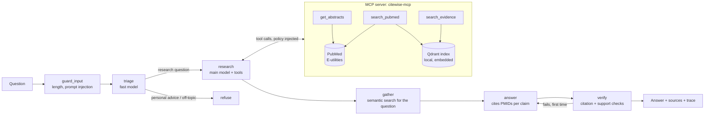

# Citewise

A biomedical research agent that answers only with evidence it can cite. Ask a research question;
the agent searches PubMed through its own MCP server, reads abstracts, answers from what it read,
and checks every citation before showing it. Claims that fail the check are removed, never shown.

Built with Claude (via LangChain), LangGraph, the Model Context Protocol, Qdrant and FastAPI.

**Status: v1.** Agent, MCP server, guardrails, evaluation harness, tracing, API and demo page are
in this repository, with 61 offline tests. On 100 PubMedQA test questions the agent found the
source study in 99% of cases and answered 68% correctly, 18 points above Claude without retrieval;
when it committed to an answer it was as accurate as Claude handed the paper (see [Results](#results)).

## How it fits together



The agent is a LangGraph state graph (`src/citewise/agent.py`):

1. **guard_input** rejects empty, overlong and prompt-injection inputs before any model is called.
2. **triage** (fast model) refuses personal medical advice and off-topic requests, and suggests
   PubMed queries.
3. **research** (main model) calls the MCP tools: search PubMed, read abstracts, search the index.
   A tool budget caps the loop.
4. **tools** runs each call with the evidence policy injected, then filters the results again.
5. **gather** always runs a plain keyword search of PubMed for the question and reads the top three
   abstracts, then a semantic search of the index, so the answer is grounded even if the model
   searched poorly. If the model made no tool calls, gather also runs its suggested searches.
6. **answer** (main model) answers from the evidence only, as claims that each cite PMIDs, with
   two verdicts: what **the study the question describes** found (if one of the retrieved papers is
   that study), and what **the evidence as a whole** suggests. A user asking "does X reduce Y in Z?"
   sees both the matching study's result and whether older studies agree.
7. **verify** checks the citations, then asks the fast model whether the cited passages support each
   claim. A study verdict must name a retrieved paper and be backed by a claim citing it. A failing answer goes back once with the problems listed; claims that still fail are
   removed, and if nothing survives the verdict becomes `insufficient_evidence`.

The knowledge service is a separate MCP server (`src/citewise/mcp_server.py`). The agent loads its
tools with `langchain-mcp-adapters` over one long-lived stdio session. Any other MCP client, such as
Claude Desktop, can use the same server.

## Guardrails

| Where | What | How it is tested |
| --- | --- | --- |
| Input | Length limits; prompt-injection patterns; triage refuses personal medical advice and off-topic questions | `test_input_checks`, `test_prompt_injection_is_refused_before_any_model_call`, `test_personal_medical_advice_is_refused_by_triage` |
| Tools | An evidence policy (excluded PMIDs, latest publication year) is injected into every tool call and hidden from the model, so the model cannot widen what it may read. Every tool result is filtered again in the agent. | `test_excluded_and_later_papers_never_reach_the_evidence`, `test_policy_is_enforced_even_if_a_tool_returns_forbidden_papers` |
| Retrieved text | Abstracts are wrapped as untrusted `<document>` blocks; tags inside them are neutralised | `test_evidence_is_wrapped_as_untrusted_documents`, `test_documents_cannot_close_their_own_wrapper` |
| Output | Every claim must cite a PMID that the agent actually retrieved; a verdict needs at least one cited claim; a model check confirms the cited passages support each claim | `test_invented_citation_triggers_a_retry_with_feedback`, `test_claims_that_keep_failing_are_removed_not_shown`, `test_unsupported_claims_are_caught_by_the_support_check` |
| Cost | Tool budget per question; per-client rate limit and daily token budget in the API | `test_tool_budget_stops_a_model_that_never_stops_searching`, `test_rate_limit_per_client`, `test_daily_budget_stops_the_demo` |
| Secrets | The MCP server subprocess gets only `CITEWISE_*`, `NCBI_*` and system variables, never the Claude API key | `config.server_environment` |

## Evaluate

[PubMedQA](https://github.com/pubmedqa/pubmedqa) (Jin et al., EMNLP 2019) has 1,000 expert-labelled
yes/no/maybe questions; the official test split is 500. Each question is the title of a PubMed
paper. `citewise-eval` compares four settings on the same questions:

| Setting | What the model sees |
| --- | --- |
| `closed_book` | Nothing but the question. Claude answers from its own knowledge (which may include the paper itself, from training). |
| `with_context` | The paper's own abstract without its conclusion: the standard PubMedQA setting, the upper reference point. |
| `find_and_read` | Whatever the agent finds in PubMed. It must **find the question's own paper itself**, sees it only as the abstract without its conclusion, and every other paper must be from earlier years. This is the retrieval setting and the headline number. |
| `agent` | Whatever the agent finds, **with the source paper excluded and only earlier papers allowed**: it must forecast the study's result from prior literature. The hard case. |

`find_and_read` against `with_context` measures what retrieval costs: both see the same abstract,
but one is handed it and the other has to find it among PubMed's records. The report gives how
often the agent found the source paper. Every rule goes through the same evidence policy as in
production, and the report counts any question where forbidden text (an excluded or newer paper,
or the source paper's conclusion) reached the evidence: it must be 0.

Before a paid run, a free check says how often a plain PubMed search finds each source paper
(no model calls):

```bash
citewise-eval --download --check-retrieval --split test --limit 100
```

### Protocol: tune on dev, report on test

PubMedQA's 1,000 labelled questions split into the official **test** set (500) and a **dev** set
(the other 500). Every design choice, such as the verdict policy or the tool budget, is compared on
dev. The test split is run once with the chosen configuration, and that is the number reported.

```bash
# compare two agent configurations on 50 dev questions
citewise-eval --download --split dev --limit 50 --modes agent --policy strict
citewise-eval --split dev --limit 50 --modes agent --policy best_supported
citewise-eval --compare results/<model>/dev/agent-strict-t6.jsonl results/<model>/dev/agent-best_supported-t6.jsonl

# the reported numbers: the chosen configuration, once, on the test split
citewise-eval --split test --limit 100 --modes closed_book,with_context,find_and_read
```

Results are written per question to `results/<model>/<split>/`: `closed_book.jsonl` and
`with_context.jsonl` for the baselines, and `<setting>-<policy>-t<tool budget>.jsonl` for each agent
setting and configuration, so answers from different configurations never mix and an interrupted run resumes
where it stopped. Samples are nested: `--limit 100` contains every question of `--limit 30` with the
same seed, so a larger run reuses the answers already saved. Each run writes
`report-<configuration>.md` and `.json`: accuracy and macro-F1 with bootstrap 95% intervals, paired
differences between settings on the same questions, and agent behaviour (tool calls, claims removed
by the verifier, `insufficient_evidence` rate). `--gate agent:0.55` exits with code 2 if accuracy
falls below 0.55, for CI.

### Abstention: two verdict policies and two extra metrics

The agent may answer `insufficient_evidence`, which PubMedQA scores as `maybe`. With only earlier
literature allowed, the evidence is often indirect, so a cautious agent abstains a lot, and plain
accuracy then hides how often it is right when it does commit. The report therefore also gives, for
every setting, **how often it commits to yes or no** and **its accuracy on those committed answers**.

Two verdict policies (`--policy`, or `CITEWISE_VERDICT_POLICY`):

- `strict` (default): abstain unless the documents answer the question.
- `best_supported`: give the verdict the evidence leans toward, say in the summary when the evidence
  is indirect, and abstain only when nothing relevant was found.

Both keep every guardrail: each claim must still cite a retrieved paper and pass the support check.

### Results

_First run, 30 test questions, `strict` policy, tool budget 6 (too few questions for firm
conclusions; the intervals are about ±17 points):_ closed_book 63.3%, with_context 86.7%, agent
50.0%. The agent committed to yes or no on 12 of 30 questions and was right on 11 of them; 14 of its
15 errors were abstentions on questions whose answer was yes or no. The source paper reached the
evidence on 0 questions. That finding motivated the dev-split comparison of the two verdict policies.

_Dev comparison of the verdict policies (50 dev questions, earlier-literature setting):_ strict
24.0%, best_supported 28.0%, a difference of -4.0 points (95% CI -14 to +6): no measurable
difference, so `strict` stays the default (fewer claims removed by the verifier, 14% fewer tokens).
Under both policies the agent answered maybe on most questions: excluding the source paper turns
PubMedQA into forecasting a study's result from prior literature, which motivated `find_and_read`.

**Version a1 test results: 100 test questions, Claude Sonnet 5.5, `strict` policy, tool budget 6**

| Setting | Accuracy (95% CI) | Commits to yes/no | Accuracy when committed (95% CI) |
| --- | ---: | ---: | ---: |
| `closed_book` | 50.0% (40.0 to 60.0) | 71% | 63.4% (52.1 to 74.6) |
| `with_context` | 77.0% (69.0 to 85.0) | 83% | 81.9% (73.5 to 90.4) |
| `find_and_read` | 49.0% (39.0 to 59.0) | 57% | 71.9% (59.6 to 82.5) |

- **Retrieval works.** The agent found the source paper in 84% of questions (a plain keyword search
  finds it in the top 10 for 98%, see `citewise-eval --check-retrieval`).
- **Reasoning works when it commits.** On the 50 questions where it found the paper and answered
  yes or no, it was right 74% of the time, against 78% for `with_context` on the same questions.
- **The gap is hedging.** After finding the paper it still answered maybe on 34 questions, 29 of
  which had a yes or no answer: it weighs the source study together with older studies it also
  retrieved (about 4 papers per question), and when they disagree it says maybe. `with_context`,
  which sees only the source abstract, got 22 of those 34 right. A research assistant should weigh
  the literature; PubMedQA asks about one study. Closing that gap without tuning to the benchmark
  is the next step.

**Version a2** addresses both losses: the answer now gives a separate verdict for the study the
question describes (PubMedQA scores that one; the wider-evidence verdict is still reported), and
gather always runs the plain keyword search, which finds the source paper in the top 10 for 98% of
questions. Result files carry the version (`find_and_read-strict-t6-a2.jsonl`), so the a1 and a2
runs never mix.

**Version a2 test results: the same 100 test questions, Claude Sonnet 5.5, `strict`, tool budget 6**

| Setting | Accuracy (95% CI) | Commits to yes/no | Accuracy when committed (95% CI) |
| --- | ---: | ---: | ---: |
| `closed_book` | 50.0% (40.0 to 60.0) | 71% | 63.4% (52.1 to 74.6) |
| `with_context` | 77.0% (69.0 to 85.0) | 83% | 81.9% (73.5 to 90.4) |
| `find_and_read` a1 | 49.0% (39.0 to 59.0) | 57% | 71.9% (59.6 to 82.5) |
| `find_and_read` a2 | **68.0%** (59.0 to 77.0) | 73% | **82.2%** (74.0 to 90.4) |

- **a2 against a1:** +19 points (95% CI +11 to +27).
- **Retrieval now clearly helps:** +18 points over `closed_book` (95% CI +6 to +29).
- **Finding the paper still costs a little:** -9 points against `with_context`, which is handed the
  abstract (95% CI -16 to -3). When the agent commits to an answer it is as accurate as
  `with_context` (82.2% against 81.9%).
- **Retrieval:** the agent found the source paper in 99% of questions and named it as the study
  asked about in 94%.
- **Guardrails held:** forbidden text reached the evidence on 0 questions; the verifier removed
  unsupported claims from 26% of answers. About 19,000 tokens and 45 seconds per question.
- **Dev check (50 dev questions):** `find_and_read` a2 78.0% against `with_context` 74.0% (+4 points,
  95% CI -4 to +12).

A caveat on method: the a2 changes were designed after inspecting a1's errors on these same test
questions, so the dev result, on questions not used for that analysis, is the cleaner confirmation
that the improvement generalises. A fresh sample of test questions would be cleaner still.
- **Overall**, `find_and_read` and `closed_book` cannot be told apart (-1 point, 95% CI -13 to +11).
  Claude may also remember these papers from training, so `closed_book` is not a no-information
  baseline.
- **Guardrails held (v1).** Forbidden text (an excluded or newer paper, or the source paper's conclusion)
  reached the evidence on 0 questions, and the verifier removed unsupported claims from 26% of
  answers. Mean cost: about 17,000 tokens and 35 seconds per question.

How to read them: `with_context` should score highest because the model reads the paper itself.
The interesting comparison is `agent` against `closed_book`: does retrieving earlier literature
help beyond what the model already knows? If the paired interval contains zero, the data cannot
tell them apart, and the report says so.

## Observability

Every response carries a trace: time per step, tokens per model, tool calls with their arguments
and result counts, and the estimated cost if `CITEWISE_PRICES` is set. Each run also writes one
JSON log line (`agent_run`). With `LANGFUSE_PUBLIC_KEY` and `LANGFUSE_SECRET_KEY` set and
`pip install ".[tracing]"`, every model call is also sent to Langfuse.

## Run it

You need Python 3.11+ (or Docker) and a Claude API key. Every command reads `.env` from the current
folder, so put your settings there once:

```bash
cp .env.example .env            # Windows: copy .env.example .env
# then add ANTHROPIC_API_KEY and NCBI_EMAIL to .env
```

With Docker:

```bash
docker compose up --build       # then open http://127.0.0.1:8000
```

Without Docker (macOS/Linux; on Windows use `.venv\Scripts\activate`, or a conda environment):

```bash
python -m venv .venv && source .venv/bin/activate
pip install -e ".[dev]"
pytest                          # 61 tests, offline, no API key needed

citewise-ask "Does vitamin D supplementation reduce fracture risk in older adults?"
citewise-api                    # http://127.0.0.1:8000
```

The first run downloads a small embedding model (BAAI/bge-small-en-v1.5, via fastembed). The
evidence index is kept in `.citewise/index` (in Docker, a named volume). Embedded Qdrant allows one
process per index folder, so give the API and an evaluation run different `CITEWISE_INDEX_PATH`
values if you run both at once.

### Use the MCP server from Claude Desktop

```json
{
  "mcpServers": {
    "citewise": {
      "command": "/path/to/citewise/.venv/bin/citewise-mcp",
      "env": { "NCBI_EMAIL": "you@example.com" }
    }
  }
}
```

`citewise-mcp --http --port 8765` serves the same tools over streamable HTTP instead of stdio.

## Configuration

| Variable | Default | Purpose |
| --- | --- | --- |
| `ANTHROPIC_API_KEY` | (required) | Claude API key |
| `CITEWISE_MODEL` | `claude-sonnet-5-5` | Research and answer model |
| `CITEWISE_FAST_MODEL` | `claude-haiku-5-5` | Triage and citation-support model |
| `CITEWISE_MAX_TOOL_CALLS` | `6` | Tool budget per question |
| `CITEWISE_VERDICT_POLICY` | `strict` | `strict` abstains unless the evidence answers the question; `best_supported` commits to what the evidence leans toward |
| `CITEWISE_CHECK_SUPPORT` | `1` | Set `0` to skip the model support check (citation checks always run) |
| `CITEWISE_MAX_TOKENS` | `8192` | Output token limit per call, with room for adaptive thinking |
| `CITEWISE_EFFORT` | | Optional reasoning effort (`low`, `medium`, `high`) |
| `CITEWISE_STRUCTURED_OUTPUT` | `json_schema` | Anthropic native structured outputs; `function_calling` for older models |
| `NCBI_EMAIL`, `NCBI_API_KEY` | | NCBI contact and rate limit (3/s without key, 10/s with) |
| `CITEWISE_INDEX_PATH` | `.citewise/index` | Qdrant folder, or `:memory:` |
| `CITEWISE_EMBEDDING_MODEL` | `BAAI/bge-small-en-v1.5` | fastembed model |
| `CITEWISE_PRICES` | | JSON, model to [input, output] USD per million tokens, for cost estimates |
| `CITEWISE_RATE_LIMIT_PER_MINUTE` | `5` | Per client, API only |
| `CITEWISE_DAILY_TOKEN_BUDGET` | `2000000` | Across all clients, API only |

## Tests

`pytest` runs 61 tests with no network and no API key, against a small set of clearly synthetic
papers (`tests/fixtures/papers.json`, PMIDs 90000001 to 90000008). Besides unit tests they cover:

- **The real MCP path**: the server runs as a subprocess and the agent talks to it over stdio through
  `langchain-mcp-adapters`.
- **The real Claude path**: `ChatAnthropic` with tool calling and structured output runs against a
  local mock of the Anthropic Messages API, using the real model names (langchain-anthropic changes
  behaviour per model). The test checks the requests (native structured output, tools offered,
  policy parameters hidden, tool results sent back) and the token accounting.
- **The evaluation harness**: leakage policy, metrics against hand-computed values, resumable runs,
  and the report.

## Layout

```
src/citewise/
  agent.py         LangGraph graph: guard, triage, research, tools, gather, answer, verify
  mcp_server.py    MCP server: search_pubmed, get_abstracts, search_evidence
  toolbox.py       MCP client side: loads tools, hides policy parameters from the model
  pubmed.py        NCBI E-utilities client (and an offline stand-in for tests)
  index.py         Qdrant evidence index with section-aware passages
  guardrails.py    input checks, evidence policy, document wrapping, citation validation
  llm.py           Claude via langchain-anthropic, prompts, structured outputs
  schemas.py       Pydantic models for every structured output
  tracing.py       per-request traces, JSON logs, optional Langfuse
  api.py           FastAPI: /ask, /health, demo page, rate limit, daily budget
  cli.py           citewise-ask
  eval/            PubMedQA loader, runner, metrics, report, citewise-eval
tests/             61 offline tests
```

## Limits

- **Abstracts only.** Full texts are not read, so details reported only in a paper's body are missed.
- **The support check is a model judging a model.** It catches claims that are plainly not in the
  cited passages; it is not a substitute for reading the paper.
- **PubMedQA measures yes/no/maybe questions.** It does not measure the quality of open-ended
  summaries. The citation checks apply to every answer, but only yes/no/maybe accuracy is scored.
- **In-memory demo protection.** The rate limit and daily budget reset when the process restarts.
- **Not medical advice.** The agent refuses questions about an individual's care, and every answer
  says so.

Data: PubMed records through NCBI E-utilities, subject to the
[NCBI usage policies](https://www.ncbi.nlm.nih.gov/home/about/policies/). PubMedQA is MIT licensed.
